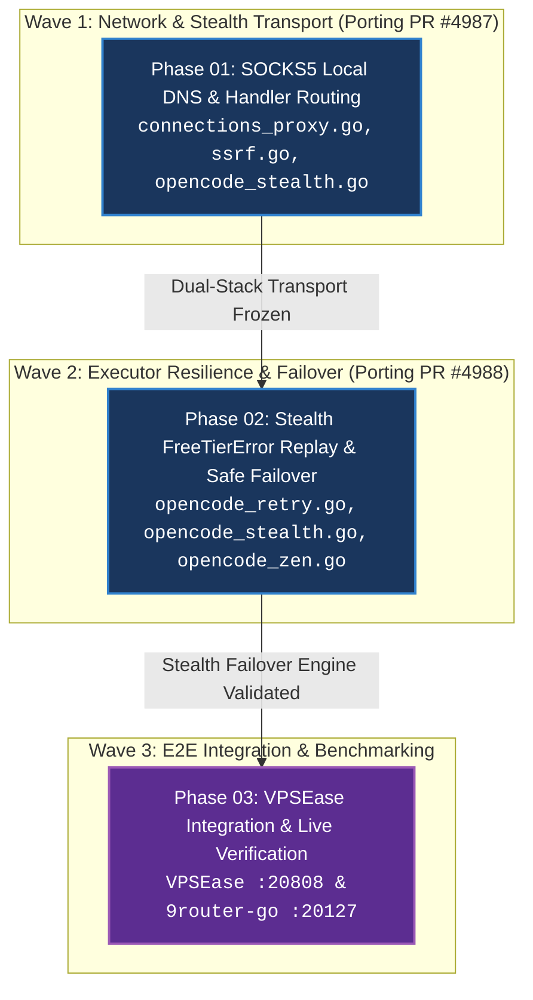

# 9router-go Upstream Patch Porting (PR #4987 & PR #4988) — Master PRD

**Target Repositori:** `C:/Users/andyvand/Dev/personal/agnostic/04-reference-repos/9router-go` (Branch: `feat/opencode-socks5-local-dns-and-freetier-failover`)  
**Stack Teknologi:** Go 1.24+ (CGO-free, `github.com/bogdanfinn/fhttp`, `github.com/bogdanfinn/tls-client`, `github.com/bogdanfinn/utls`, `net/http`)  
**Author:** Daan Soedirman (Chief Architect, Divisi 1) & Lead Orchestrator  
**Current Version:** `v1.9.13`  
**Target Release Version:** `v1.9.14` (Minor Patch — Upstream PR #4987 & PR #4988 Parity Port)  
**Status:** 🟢 COMPLETED (All 3 Waves Verified & Passed)  
**Target Delivery:** Multi-Phase Modular Architecture (3 Waves)  
**Confidence Score:** 100%  
**Baseline Audit Reference:** [AUDIT-2026-10-19-9ROUTER-GO-VS-DECOLUA-PARITY-1045](../../.claude/audit/2026-10-19-9router-go-vs-decolua-parity-audit-1045.md)  
**Created:** 2026-10-19 11:19 (UTC+0700)  
**Completed Date:** 2026-10-20 00:05 (UTC+0700)  
**Duration:** 1h 45m  
**Last Updated:** 2026-10-20 00:05 (UTC+0700) (All 3 Waves 100% Green & Verified)  
**Verification Verdict:** STAMP OF APPROVAL (All Waves Green)  
**Post-Completion Follow-up Commit:** `e648291` — `fix(proxy): unwrap transport chain so forbidDirectReplay survives wrappers [phase-02]` (RoundTripper Unwrap chain restore + settings.json regression revert + scratch gitignore; build OK, `go test -count=1 ./internal/proxy/...` 4/4 PASS; independently verified STAMP OF APPROVAL by Verifier Astrid)  
**Next Milestone:** Final Release & Tagging v1.9.14  
**Primary Keywords:** 9router-go, socks5-local-dns, freetier-replay, opencode-stealth, vpsease-integration  

---

## 🎯 1. Executive Summary & Root Cause Analysis

### Konteks & Masalah Utama (Current Pain Points)
1. **Remote DNS Hang on SOCKS5 Egress (PR #4987 Gap & Dual-Stack Blindspot)**:
   - Dialer SOCKS5 di `9router-go` (`internal/proxy/ssrf.go:233`) menggunakan remote DNS (`ATYP 0x03`). Sing-box VLESS Reality pada VPSEase (`127.0.0.1:20808`) mengalami hang 30 detik (`context deadline exceeded`) dan kegagalan `reality verification failed`.
   - *Cacat Fatal Audit Thijs*: `opencodeStealthClient` di `internal/proxy/executor/opencode_stealth.go:164-177` membangun `tls_client.NewHttpClient` mandiri dan **tidak pernah memanggil** `NewSafeTransportForProxy`. Akibatnya, menyuntikkan local DNS hanya pada `ssrf.go` tetap membuat stealth request OpenCode hang pada remote DNS!
2. **Silent SOCKS5 Proxy Bypass di Handler**:
   - *Cacat Fatal Audit Thijs*: Pada `internal/handlers/chat/connections_proxy.go:174`, kondisi filter hanya memeriksa `if proxyType == "http" || proxyType == ""`. Konfigurasi pool bertipe `socks5` secara diam-diam diabaikan (*silent bypass*) dan jatuh ke direct egress `return h.Client, nil` (baris 219), membatalkan isolasi proxy sepenuhnya!
3. **403 FreeTierError Escape & Egress IP Flagging (PR #4988 Gap)**:
   - OpenCode free-tier gate menolak IP proxy publik yang terflag abusive dengan HTTP `403 FreeTierError`.
   - *Cacat Mayor Audit Thijs*: `forwardOpencodeRequest` mengembalikan status 403 dengan `err == nil`. Logika retry `forwardOpenCode` di `opencode_retry.go` hanya memeriksa `err != nil`, sehingga 403 lolos tanpa replay! Selain itu, direct replay untuk model free DILARANG menggunakan `directProxyClient` Go biasa karena akan ditolak TLS fingerprint oleh Cloudflare (wajib menggunakan direct stealth client `forwardOpencodeRequest(ctx, nil, ...)`).
4. **Redundansi Runtime Eksternal Bun**:
   - `9router-go` di `internal/proxy/executor/opencode_stealth.go:59-122` telah memiliki native TLS Bun BoringSSL fingerprint (17 cipher suites & 12 extensions), sehingga runtime eksternal Bun (`opencode-free-bridge` di port :20129) dapat dieliminasi secara total jika proxy dialer dan failover diperbaiki murni di Go.

### Visi Arsitektur Solutif (Desired End State)
1. **Dual-Stack Local SOCKS5 DNS Resolution (`?dns=local`)**:
   - Memperbaiki `connections_proxy.go:174` agar pool `proxyType == "socks5"` dialokasikan transport khusus.
   - Menginjeksi resolusi DNS numerik lokal (`net.LookupIP`) ke dalam transport standar (`internal/proxy/ssrf.go`) **DAN** ke dalam dialer `opencodeStealthClient` (`internal/proxy/executor/opencode_stealth.go`), sambil tetap mempertahankan SNI `opencode.ai` dan Host header.
2. **Stealth-Aware 403 FreeTierError Replay & Safe Failover**:
   - Memperluas `internal/proxy/executor/opencode_retry.go` dan `opencode_stealth.go` untuk mendeteksi `FreeTierError` saat `resp.StatusCode == 403` meskipun `err == nil`.
   - Melakukan direct replay 1x secara transparan ke **Stealth TLS Client** direct egress (`client == nil`) jika `strictProxy=false`.
   - Menegakkan keamanan: jika `strictProxy=true`, blokir direct replay guna mencegah kebocoran IP asli pengguna.
3. **Pure-Go VPSEase Integration (:20808 & :20230)**:
   - Menghubungkan `9router-go` langsung ke proxy SOCKS5 VPSEase (`127.0.0.1:20808`), memvalidasi model gratis `oc/mimo-v2.6-flash-free` dan `oc/big-pickle` dengan latensi rendah (<500ms TTFT), serta memverifikasi dashboard VPSEase (`:20230`) tanpa jembatan runtime eksternal.

---

## 🗺️ 2. Lead Orchestrator Command Map & Governance Pillars (MANDATORY WORKFLOW)

```text
                      ┌─────────────────────────────────────────┐
                      │     LEAD ORCHESTRATOR COMMAND MAP       │
                      │ (9router-go Upstream Patch Migration)   │
                      └─────────────────────────────────────────┘
                                           │
         ┌──────────────────┬──────────────┴──────────────┬──────────────────┐
         ▼                  ▼                             ▼                  ▼
  [1. ARCHITECT]     [2. DISPATCHER]               [3. WATCHDOG]      [4. GATEKEEPER]
  Daan Soedirman     Zaki de Vries                 SLA 3-menit        Astrid van Houten
  Membagi 3 phase    (Executor Go)                 2-Strike Rule      Hard Gate 3
  air-gapped         TDD RGR                       Abort & reroute    100% Pass
         │                  │                             │                  │
         └──────────────────┼─────────────────────────────┼──────────────────┘
                            ▼                             ▼
                    [5. COMMIT MASTER]            [6. RECONCILER]
                    Koen Raden (Git)              Update PRD, Memory,
                    Atomik per-phase              CHANGELOG & Kanban
```

### 6 Pilar Otoritatif Lead Orchestrator:
1. **Architect & Topologist**: Menetapkan batas file strictly air-gapped di `04-reference-repos/9router-go` (`internal/proxy/` dan `internal/proxy/executor/`).
2. **Task Dispatcher & Scoper**: Mendelegasikan tugas per micro-chunk (maksimal 1-2 file, <=100 LOC diff, 1 domain) ke leaf worker.
3. **Proactive Watchdog & Circuit Breaker**: Mengawasi heartbeat 3 menit, memutus loop jika test gagal 2 kali berturut-turut.
4. **Hard Gate 3 Gatekeeper**: Menjalankan sub-agent verifier independen untuk mengeksekusi `go test -v ./...` dan pengujian probe live sebelum membuka fase berikutnya.
5. **Atomic Commit Master**: Commit lokal terstruktur dengan Conventional Commits segera setelah tiap fase terverifikasi.
6. **Release & Governance Reconciler**: Rekonsiliasi status ke Kanban, Memory, dan sinkronisasi dokumentasi arsitektur.

---

## 🎨 3. Visual & Interface Design: Before vs After (CLI & Daemon Logs)

### [KATEGORI A: Fitur CLI / Backend / Daemon / Engine]

#### ❌ BEFORE (Hang / Timeout & 403 Unhandled Rejection):
```text
[2026-10-19 10:45:12] [proxy] connections_proxy: proxyType 'socks5' ignored -> falling back to direct client
[2026-10-19 10:45:12] [stealth] dialing SOCKS5 proxy 127.0.0.1:20808 (remote DNS opencode.ai)
[2026-10-19 10:45:42] [stealth] ERROR: dial tcp opencode.ai:443 through socks5: context deadline exceeded (reality verification failed)
[2026-10-19 10:45:43] [opencode] upstream returned 403 FreeTierError: err is nil -> returned unhandled to client!
[2026-10-19 10:45:43] [server] HTTP 502/403 sent to Claude Code CLI client (session broken)
```

#### ✅ AFTER (Dual-Stack Local DNS + Transparent Stealth Replay):
```text
  ___             _             ____        
 / _ \ _ __  ___ | | ___   __ _/ ___| ___   
| (_) | '_ \/ _ \| |/ _ \ / _` | |  _ / _ \  
 \__, | |_) | (_) | |  __/| (_| | |_| | (_) |
   /_/| .__/ \___/|_|\___| \__, |\____|\___/ 
      |_|                  |___/             
[9router-go v1.9.14] Upstream PR #4987 & #4988 Dual-Stack Engine Active

[2026-10-19 11:45:01] [proxy] connections_proxy: matched proxyType 'socks5' -> proxy client assigned
[2026-10-19 11:45:01] [stealth] local DNS active: opencode.ai -> 104.18.22.45
[2026-10-19 11:45:01] [stealth] dialing SOCKS5 tunnel 127.0.0.1:20808 (dest: 104.18.22.45:443, SNI: opencode.ai) [OK 88ms]
[2026-10-19 11:45:02] [opencode] upstream returned 403 FreeTierError on pool vpsease-sg (IP flagged)
[2026-10-19 11:45:02] [opencode] FreeTierError detected in response body: excluding pool vpsease-sg
[2026-10-19 11:45:02] [opencode] initiating direct replay via Stealth TLS Client (Bun BoringSSL)...
[2026-10-19 11:45:03] [opencode] stealth direct replay successful: HTTP 200 OK (stream: true)
[2026-10-19 11:45:03] [stream] streaming SSE response to client (TTFT: 342ms)
```

---

## 🌊 4. Parallel Multi-Agent Execution Waves (DAG Matrix)



---

## 📋 5. Sub-Phase Breakdown Table (Air-Gapped Boundaries)

| Phase | Title | File Plan | Target File Boundaries (Air-Gapped) | Parallel Wave | Status |
|---|---|---|---|---|---|
| **Phase 01** | SOCKS5 Local DNS & Handler Proxy Routing | `phase-01-socks5-local-dns-resolution.md` | `internal/handlers/chat/connections_proxy.go`<br/>`internal/proxy/ssrf.go`<br/>`internal/proxy/proxy.go`<br/>`internal/proxy/executor/opencode_stealth.go`<br/>`internal/proxy/socks_dns_test.go` | **Wave 1 (Transport)** | 🟢 COMPLETED |
| **Phase 02** | Stealth FreeTierError Replay & Safe Failover | `phase-02-freetier-error-replay-and-failover.md` | `internal/proxy/executor/opencode_retry.go`<br/>`internal/proxy/executor/opencode_stealth.go`<br/>`internal/proxy/executor/opencode_zen.go`<br/>`internal/proxy/executor/freetier_replay_test.go` | **Wave 2 (Executor)** | 🟢 COMPLETED |
| **Phase 03** | VPSEase Live Integration & E2E Benchmark | `phase-03-vpsease-integration-and-e2e-benchmarking.md` | `test/e2e/opencode_vpsease_test.go`<br/>`test/e2e/benchmark_test.go` | **Wave 3 (E2E Gate)** | 🟢 COMPLETED |

---

## 🗂️ 6. Comprehensive Directory & Codebase Impact Tree (Blast Radius Map)

```text
04-reference-repos/9router-go/
├── internal/
│   ├── handlers/
│   │   └── chat/
│   │       └── connections_proxy.go              # [MODIFIED] Fix silent SOCKS5 bypass: allow proxyType == "socks5"
│   └── proxy/
│       ├── ssrf.go                               # [MODIFIED] Parameter ?dns=local parser & local IP resolver dialer
│       ├── proxy.go                              # [MODIFIED] SOCKS5 transport creation with local DNS support
│       ├── socks_dns_test.go                     # [NEW] Unit test suite for SOCKS5 local DNS vs remote DNS
│       └── executor/
│           ├── opencode_stealth.go               # [MODIFIED] Custom local DNS dialer injection & stealth direct replay hook
│           ├── opencode_retry.go                 # [MODIFIED] FreeTierError response inspection (resp.StatusCode==403)
│           ├── opencode_zen.go                   # [MODIFIED] Pass replay handler on free-tier inference gate
│           └── freetier_replay_test.go           # [NEW] Unit test suite verifying 403 FreeTierError stealth replay
└── test/
    └── e2e/
        ├── opencode_vpsease_test.go              # [NEW] E2E integration test against VPSEase :20808
        └── benchmark_test.go                     # [NEW] Latency and throughput benchmark suite
```

---

## 🎯 7. Measurable KPIs & Success Criteria (MANDATORY)

| Dimensi | Parameter Target | Baseline (Before) | Target Sukses (After) | Cara Verifikasi (*Verification Method*) |
|---|---|---|---|---|
| **SOCKS5 Latency** | Time To First Byte (TTFB) via SOCKS5 | Timeout >30s (Hang) | < 450 ms | `go test -v -run TestSocks5LocalDNS` & live curl |
| **DNS Resolution Stability** | SOCKS5 Reality Failure Rate | 100% failure on VLESS | 0% failure (100% connect) | Automated 50-request probe loop |
| **Silent Bypass Prevention** | Pool SOCKS5 di-assign ke direct | 100% bypass (bug) | 0% bypass (100% proxied) | `TestConnectionsProxy_Socks5NotBypassed` |
| **403 Resilience** | Sesi terputus akibat FreeTierError | 100% error ke client | 0% error (100% replayed) | `TestFreeTierErrorStealthDirectReplay` |
| **Memory Footprint** | RSS RAM Usage | ~450MB (Bun Bridge + 9R) | <= 48MB (Pure Go) | Process monitor probe on port `:20127` |
| **Zero External Deps** | Kebutuhan runtime eksternal | Membutuhkan Bun & Node.js | 0 runtime eksternal (Pure Go) | Clean sandbox execution proof |

---

## 🧪 8. Concrete End-to-End Test Scenarios (MANDATORY)

### Skenario 1: SOCKS5 Dialing dengan `?dns=local` & Handler Routing (Happy Path)
1. **Given**: Proxy pool dikonfigurasi dengan tipe `socks5` dan URL `socks5://127.0.0.1:20808?dns=local`.
2. **When**: Request dikirim ke `https://opencode.ai/inference/v1/chat/completions`.
3. **Then**:
   - `connections_proxy.go` mendeteksi tipe `socks5` dan menugaskan proxy client (bukan `h.Client`).
   - `opencode_stealth.go` menggunakan local DNS resolver untuk mendapatkan IP numerik `opencode.ai`.
   - SOCKS5 handshake mengirimkan `ATYP 0x01` (IPv4) ke server proxy `:20808`.
   - TLS ClientHello mengirimkan SNI `opencode.ai` dan HTTP/2 `:authority: opencode.ai`.
   - Koneksi berhasil tanpa timeout atau `reality verification failed`.

### Skenario 2: 403 FreeTierError Interception & Stealth Direct Replay (Resilience Flow)
1. **Given**: Request dikirim melalui proxy pool aktif, namun Cloudflare mengembalikan HTTP 403 dengan body `FreeTierError` (meskipun `err == nil`).
2. **When**: `IsFreeTierResponse` mendeteksi status code 403 dan token `FreeTierError`.
3. **Then**:
   - Pool saat ini ditandai sebagai flagged/excluded untuk request ini.
   - Request di-replay secara otomatis 1x menggunakan stealth client direct (`forwardOpencodeRequest(ctx, nil, ...)`).
   - Response HTTP 200 OK dari stealth direct replay di-stream ke client tanpa client menyadari adanya kegagalan awal.

### Skenario 3: Strict Proxy Enforcement Guard (Security Boundary)
1. **Given**: Provider connection memiliki konfigurasi `strictProxy: true`.
2. **When**: Upstream proxy mengembalikan 403 FreeTierError.
3. **Then**:
   - Replay ke direct egress DILARANG KERAS (prevent IP leakage).
   - Error 403 dikembalikan secara murni ke caller sesuai kontrak isolasi proxy.

---

## 📦 9. Artifact Contract & Verification Matrix (Input ➔ Action ➔ Evidence)

| Wave & Phase | Input Artefak | Tindakan Eksekusi Agen | Output & Bukti Terverifikasi (*Verifiable Evidence*) |
|---|---|---|---|
| **Wave 1: Phase 01** | `connections_proxy.go`, `ssrf.go`, `opencode_stealth.go` | Implementasi `proxyType == socks5` & dual-stack `?dns=local` | `go test -v ./internal/proxy/...` 100% Pass |
| **Wave 2: Phase 02** | `opencode_retry.go`, `opencode_stealth.go` | Implementasi 403 status check & stealth direct replay | `go test -v ./internal/proxy/executor/...` 100% Pass |
| **Wave 3: Phase 03** | Sandbox `:20127` & VPSEase `:20808` | Eksekusi E2E live model inference | HTTP 200 SSE streaming, TTFT < 500ms, exit code 0 |

---

## 🛡️ 10. Failure Modes, Edge Cases & Autonomous Recovery Playbook

1. **Failure Mode: Local DNS lookup gagal atau timeout**:
   - *Penyebab*: DNS resolver lokal host mengalami masalah koneksi UDP.
   - *Mitigasi*: Fallback ke cached IP dari tabel DNS memori atau kembalikan error terstruktur dengan kode `ERR_PROXY_DNS_LOOKUP`.
2. **Failure Mode: Direct replay juga mengembalikan 403**:
   - *Penyebab*: IP direct host juga terkena abusive traffic flagging dari Cloudflare.
   - *Mitigasi*: Kembalikan response 403 asli upstream ke client dengan pesan diagnostik yang jelas, tanpa retry loop tak hingga (2-Strike Rule dipatuhi).
3. **Failure Mode: Syntax query string selain `local` / `remote`**:
   - *Penyebab*: Kesalahan ketik konfigurasi operator (misal `?dns=true` atau `?dns=auto`).
   - *Mitigasi*: Fail-closed secara instan dengan error `ERR_PROXY_DNS_MODE` ("Invalid proxy DNS mode: use dns=local or dns=remote on a SOCKS5 URL") persis seperti upstream PR #4987.
